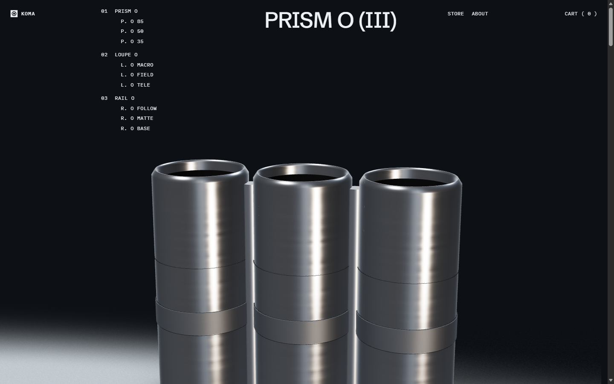
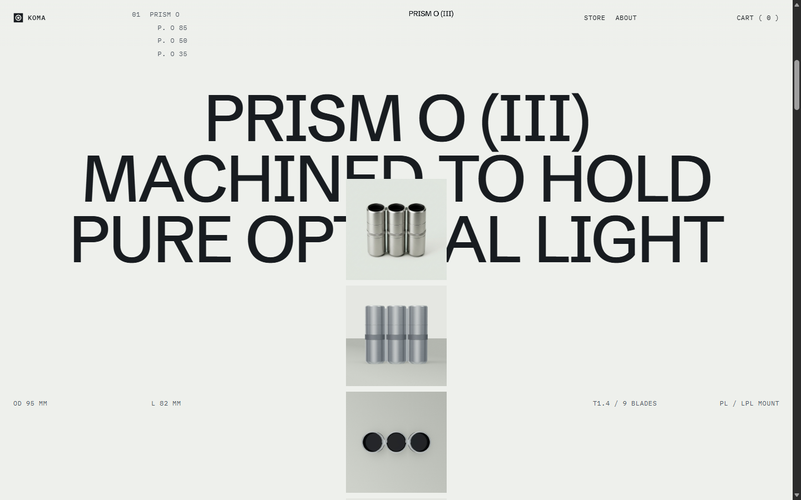
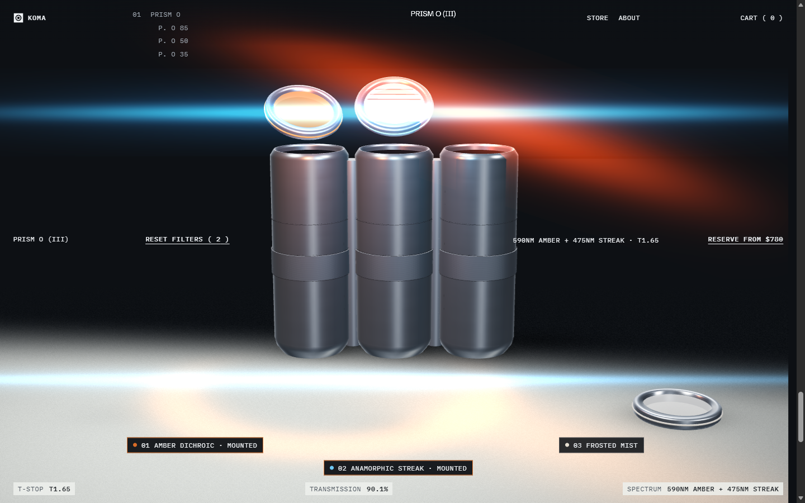

# KOMA O-III (PRISM O) · Modular Cinema Lens Monograph

**Live Demo:** [https://koma-optics.vercel.app](https://koma-optics.vercel.app) · **Repository:** [github.com/MrEuwn/koma-optics](https://github.com/MrEuwn/koma-optics)

> **Project Status:** `Speculative` (Awwwards-grade industrial hardware monograph accompanying [Rumah Wiraloka](https://wiraloka-batik.vercel.app)).

Speculative modular cinema lens and optical instrument monograph engineered with single-context WebGL2 PBR studio lighting, scroll-scrubbed architectural optical blueprints, a 3D orbital editorial gallery, and an interactive tabletop optical filter composer.

## Visual Previews

| Chiaroscuro Darkroom 3D Hero | Lab Paper Orthographic Story |
| :---: | :---: |
|  |  |



## Architecture & Craft Highlights

- **Single-Context WebGL2 Stage (`src/webgl/WebGLStageManager.js`)**: One shared `THREE.WebGLRenderer` with procedural `PMREMGenerator` studio softbox HDRI reflections drives both the Darkroom Chiaroscuro Hero and the Interactive Tabletop Filter Studio via scissor clipping, eliminating multi-context exhaustion.
- **Polarized Editorial Rhythm**: Alternates deep darkroom slate (`#0D1014`) with open laboratory paper (`#EEF0EC`), paired with an adaptive 4-zone architectural header featuring a top contrast scrim and scroll-morphing display typography (`Schibsted Grotesk` + `IBM Plex Mono`).
- **Interactive Tabletop Filter Studio (`CLICK A FILTER · BEND THE BEAM`)**: Three tactile machined-titanium drop-in optical glass filters (`01 AMBER DICHROIC`, `02 ANAMORPHIC STREAK`, `03 FROSTED MIST`) rest on a spotlighted tabletop; clicking or activating via keyboard lifts each filter into the central `PRISM O (III)` barrel and updates real-time spectral caustics and optical telemetry (`T-STOP`, `TRANSMISSION`, `SPECTRUM`).
- **Accessible Reservation Kit Drawer**: Full focus trap, keyboard `Escape` dismissal, live optical mass calculation in grams, and speculative USD allocation builder (no payments processed).
- **Instant First Paint**: Zero blocking preloader and automatic `prefers-reduced-motion` support across smooth scroll and WebGL animation loops.

## Development

```bash
npm install
npm run dev
```

## Production Build

```bash
npm run build
npm run preview
```

## Media Attribution

Curated macro optical plates in `public/media/` include Wikimedia Commons CC BY-SA 4.0 photography (`Hasselblad L3D-100c aperture`, `Canon EF-M 32mm F1.4 aperture blades`, and `Prism-side-fs`) alongside custom KOMA studio renders.
